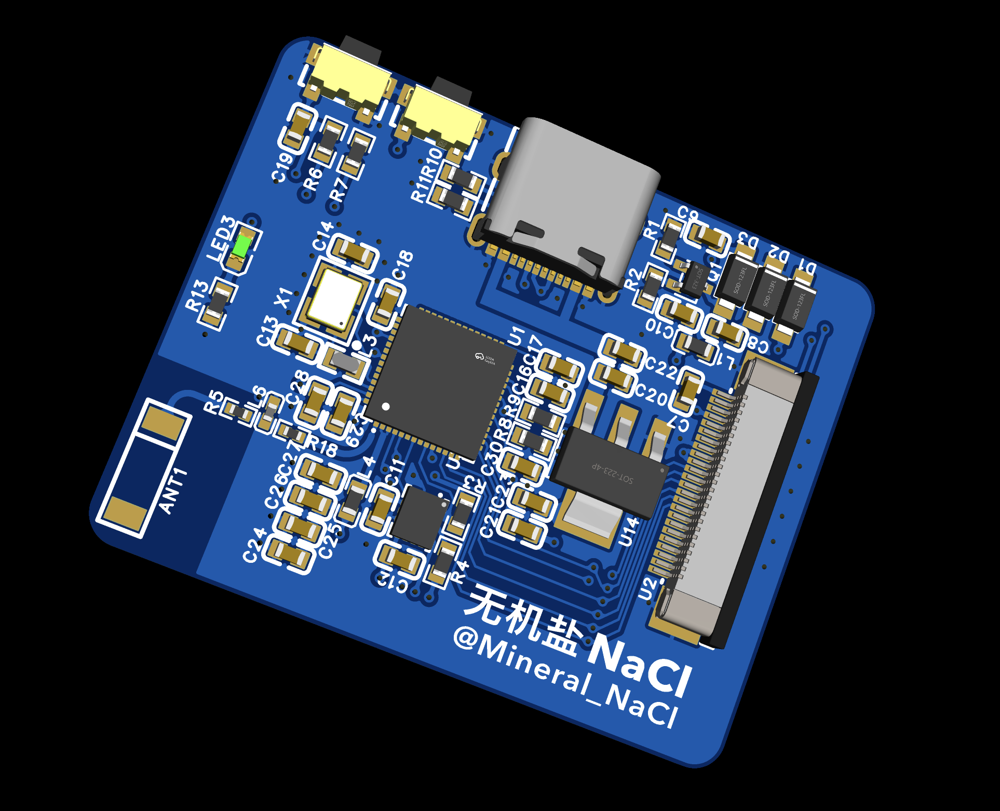
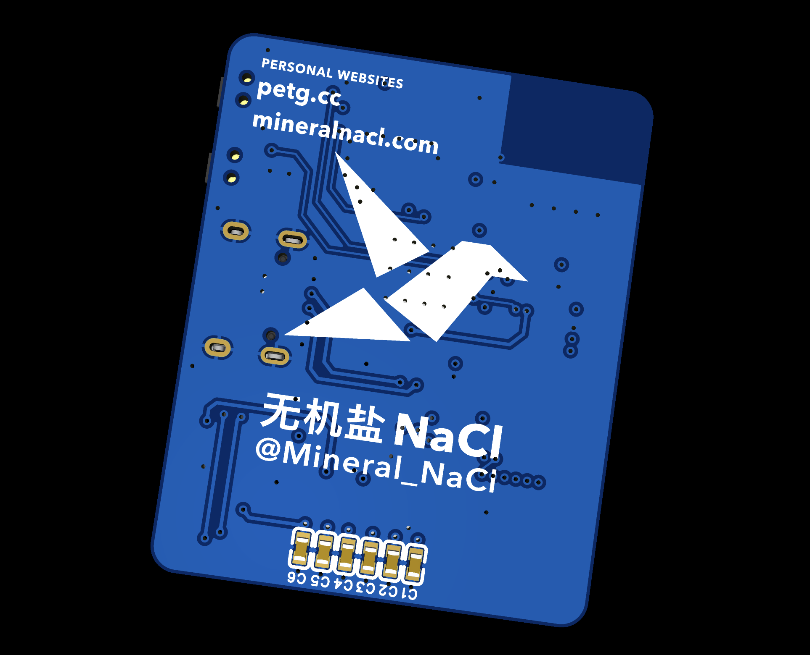
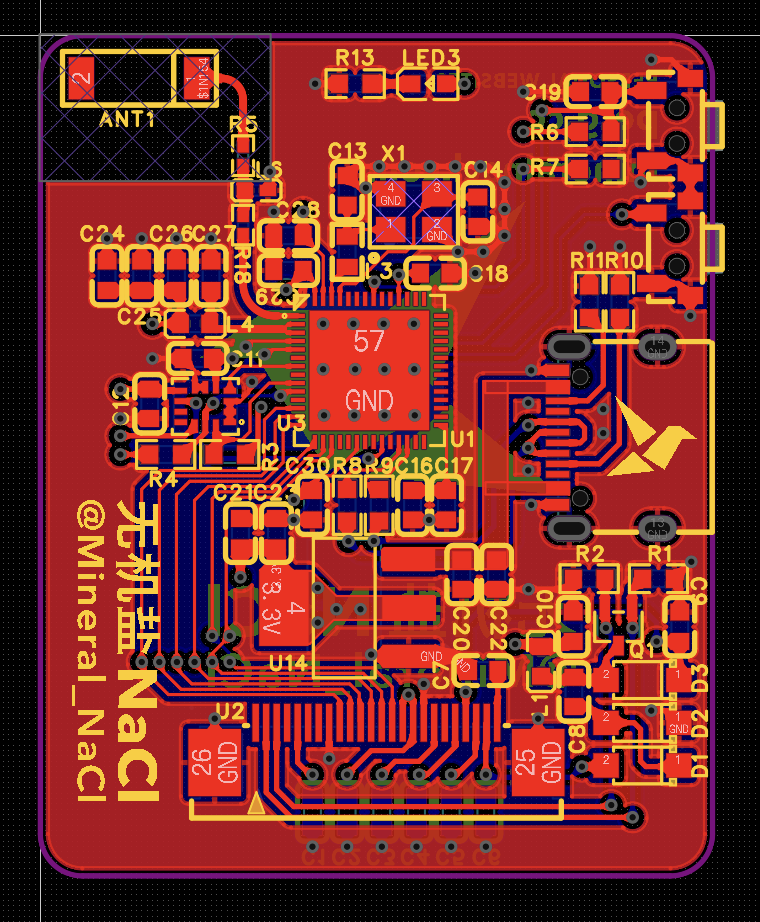
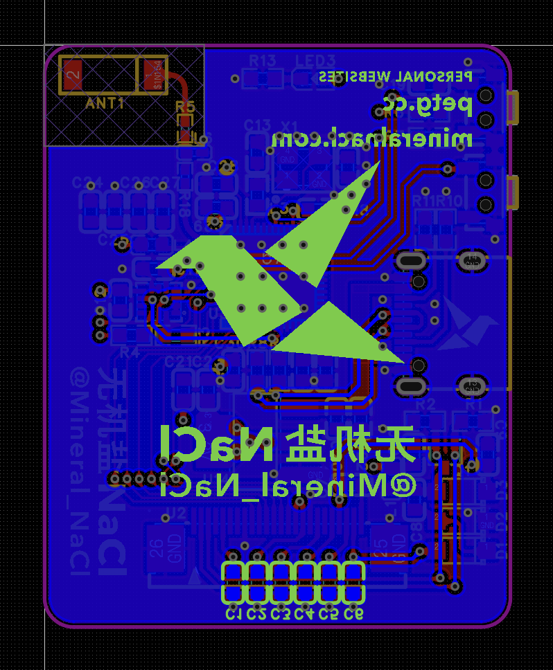

<h1 align="center">
  
  InkLark E-Paper
</h1>

  <strong>基于 ESP32-S3 的开源电子墨水屏实验平台</strong> 
  从屏幕驱动出发，探索运动感知与无线交互。

  <code>ESP32-S3</code> · <code>六轴 IMU</code> · <code>Wi-Fi / BLE</code> · <code>Hardware V1.0</code>

  <a href="https://github.com/MineralNaCl/InkLark-E-Paper">GitHub</a> ·
  <a href="https://gitee.com/Mineral_NaCl/InkLark-E-Paper">Gitee</a> ·
  <a href="#硬件组成">硬件组成</a> ·
  <a href="#硬件文件与使用">文件与使用</a>

<table align="center">
  <tr>
    <td align="center" width="50%">
       
      正面 · 3D 渲染
    </td>
    <td align="center" width="50%">
       
      背面 · 3D 渲染
    </td>
  </tr>
  <tr>
    <td align="center">
       
      正面 · PCB 布局
    </td>
    <td align="center">
       
      背面 · PCB 布局
    </td>
  </tr>
</table>

硬件设计预览 · 点击图片查看原图

## 关于项目

InkLark E-Paper 将 ESP32-S3 主控、IMU 与墨水屏驱动外围电路放在同一块板上，为电子墨水屏驱动和交互代码提供实验平台。硬件包含 LDO 电源、主控、运动传感器、Wi-Fi / 蓝牙射频电路及屏幕接口。

围绕这块板，可以开展以下方向的实验：

- **墨水屏驱动**：研究屏幕初始化、图像传输与刷新控制。
- **运动感知**：读取加速度和角速度，探索姿态变化与屏幕显示的联动。
- **无线交互**：通过 Wi-Fi 或 BLE 传输显示内容，尝试无线控制与数据更新。

当前仓库收录 **V1.0 硬件设计与制造资料**，驱动、固件及实验示例代码尚未加入。

## 硬件组成

| 模块 | V1.0 设计 | 用途 |
| --- | --- | --- |
| 电源 | AMS1117-3.3 LDO | 将 USB 5 V 转为板上 3.3 V 电源 |
| 主控 | ESP32-S3FH4R2 | 运行实验代码，协调屏幕、传感器与通信 |
| 运动感知 | LSM6DSV16XTR 六轴 IMU | 采集加速度与角速度，开展运动交互实验 |
| 无线通信 | ESP32-S3 射频外围与天线电路 | 用于 Wi-Fi / 蓝牙 LE 通信实验 |
| 墨水屏驱动与接口 | 驱动外围电路、24Pin / 0.5 mm FPC 连接器 | 连接墨水屏，提供显示控制信号与外围支持 |

ESP32-S3 的无线能力见[乐鑫产品说明](https://www.espressif.com/en/products/socs/esp32-s3)。具体器件连接与网络定义以仓库中的原理图和工程文件为准。

## 仓库结构

| 路径 | 内容 |
| --- | --- |
| [`hardware/`](hardware/) | 按版本存放硬件资料，当前为 ESP32-S3 V1.0 |
| [`img/`](img/) | 电路板预览图片、折纸鸟图标、姓名及个人站丝印 SVG |
| [`README.md`](README.md) | 中文项目说明 |
| [`LICENSE`](LICENSE) / [`hardware/LICENSE`](hardware/LICENSE) | 软件与硬件各自适用的许可证全文 |

## 硬件文件与使用

V1.0 的四份资料位于 [`hardware/hardware_V1.0(ESP32_S3)/`](<hardware/hardware_V1.0(ESP32_S3)/>)：

| 文件 | 用途 | 打开方式 |
| --- | --- | --- |
| [工程文件（.epro2）](<hardware/hardware_V1.0(ESP32_S3)/InkLark E-Paper(工程文件；导入这个) V1.0.epro2>) | 查看和修改原理图、PCB 设计 | 导入嘉立创 EDA 专业版 |
| [原理图（.pdf）](<hardware/hardware_V1.0(ESP32_S3)/InkLark E-Paper 原理图V1.0.pdf>) | 快速查阅主控、IMU 与屏幕电路 | 使用 PDF 阅读器 |
| [BOM（.xlsx）](<hardware/hardware_V1.0(ESP32_S3)/InkLark E-Paper BOM文件V1.0.xlsx>) | 查阅元件清单，用于备料与装配 | 使用 Excel 或兼容的表格软件 |
| [制板文件（.zip）](<hardware/hardware_V1.0(ESP32_S3)/InkLark E-Paper 制板文件V1.0.zip>) | 提供 Gerber、钻孔等 PCB 制造文件 | 使用 Gerber 查看器，或上传制板平台 |

### 查看与修改工程

1. 下载上表中的 `.epro2` 工程文件，使用支持该格式的 **嘉立创 EDA 专业版**。本工程记录的保存版本为 **3.2.135**。
2. 在开始页选择“导入嘉立创 EDA（专业版）”，或通过“文件 → 导入 → 嘉立创 EDA（专业版）”选择工程文件，并导入为新工程。操作入口可参考[官方导入说明](https://prodocs.lceda.cn/cn/import-export/import-easyeda-pro/)。
3. 导入后查看“主控”“imu”“屏幕”三页原理图及 PCB。需要修改电路或布局时，从这份工程文件开始。

### 备料与制板

结合原理图和 BOM 确认器件型号、封装与数量。制板时使用 `.zip` 中的 Gerber 和钻孔文件，并查看压缩包内的 `PCB下单必读.txt`；下单前核对板框、层叠与制造参数。

修改工程后，应重新导出对应版本的 BOM 与制板文件，保持设计和制造资料一致。

## 作者

**无机盐NaCl · @Mineral_NaCl** 
个人站：[petg.cc](https://petg.cc) · [mineralnacl.com](https://mineralnacl.com)

## 许可证与商业授权

Copyright © 2026 无机盐NaCl（Mineral_NaCl）。

本仓库采用分项许可，原创内容按以下范围分别授权：

| 内容 | 许可证 |
| --- | --- |
| `hardware/` 中的硬件设计与制造资料、本 README、硬件说明及 `img/` 中的原创预览图与丝印素材 | [CERN Open Hardware Licence v2 — Strongly Reciprocal（CERN-OHL-S-2.0）](hardware/LICENSE) |
| 驱动、固件及其他软件代码与其专属文档 | [GNU General Public License v3.0 only（GPL-3.0-only）](LICENSE) |

根目录 `LICENSE` 对应软件许可，`hardware/LICENSE` 对应硬件许可。两种许可证按上述范围适用，不是可任选的两种授权。第三方内容仍适用其原有许可证；上述许可不对第三方内容重新授权。

项目源文件发布于 [GitHub](https://github.com/MineralNaCl/InkLark-E-Paper) 和 [Gitee](https://gitee.com/Mineral_NaCl/InkLark-E-Paper)。

在遵守相应开源许可证的前提下，可以商业使用及销售，无须另行购买商业许可，并须履行相应的源码提供、许可与声明保留等义务。

如需超出上述开源许可范围的权限，例如闭源分发受 GPL 覆盖的衍生软件，或采用不同的硬件设计共享条件，商业授权需另行协商，并以相关权利人的书面协议为准。本说明不自动授予任何商业例外，也不替代第三方所需的授权。

商业授权联系邮箱：[petgbycc@gmail.com](mailto:petgbycc@gmail.com)。
